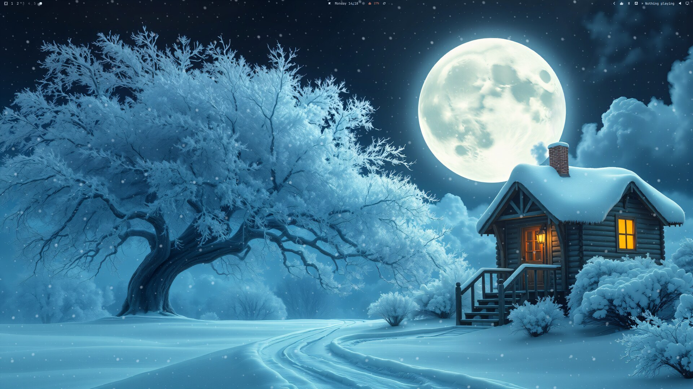
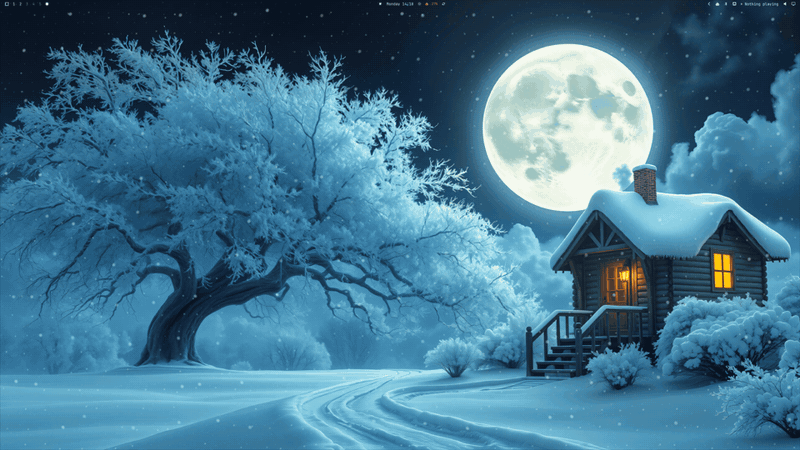
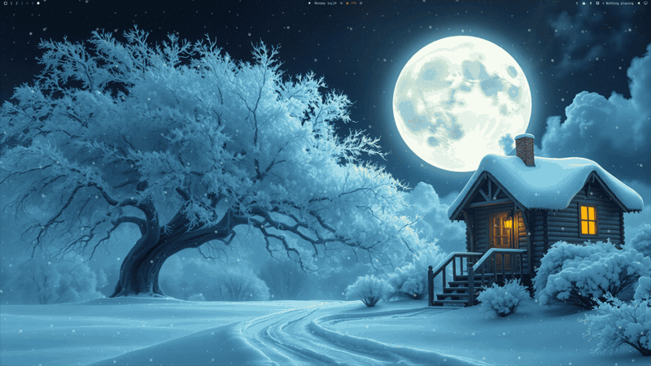
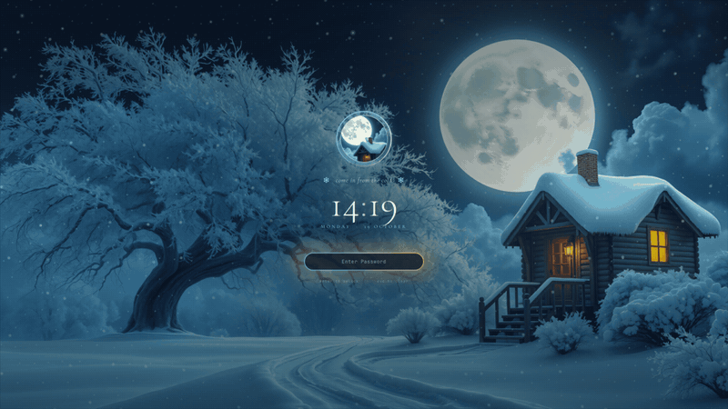
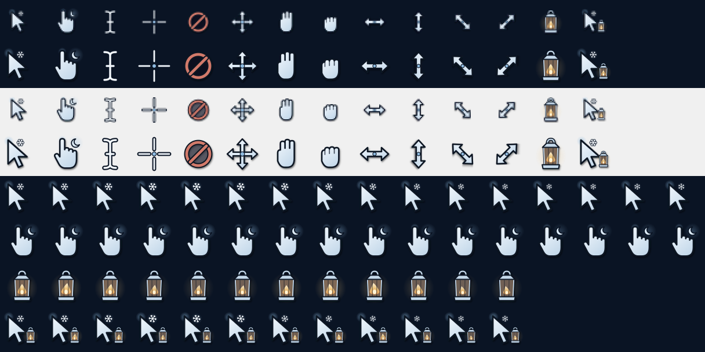
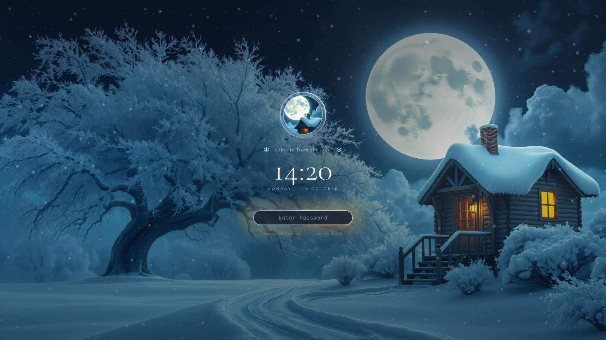
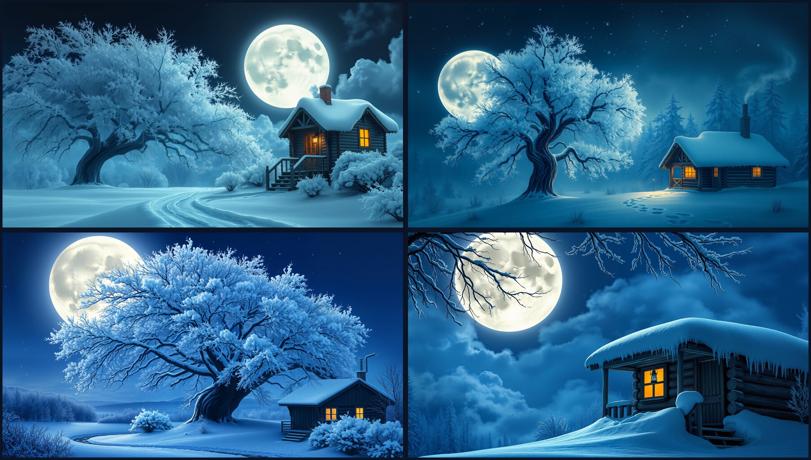

# Moonlit Hearth

A winter-night theme for [Omarchy](https://omarchy.org): a frosted tree, a full moon and a small cabin with one lit window. Snow falls on the desktop, and the lock screen, login intro, login screen, boot splash, mouse cursor and click effects all match.

The moving parts come from [Omarchy Living Themes](https://github.com/prostratepossum/omarchy-living-themes), which this theme shares with [Alpine Marmot](https://github.com/prostratepossum/omarchy-alpine-marmot-theme). Install both and switch between them (or to any other Omarchy theme) with `omarchy theme set`, and everything changes over to match.



| Live wallpaper | Login intro | Lock screen |
|---|---|---|
|  |  |  |

**Cursors** and **click effects** (a snowflake drifts down on left and right click, a faint frost ring on middle):




**Boot splash** (LUKS password prompt) and **login screen** (SDDM):




**Wallpapers**: Hearth, Snowfall, Frost Moon, Porch. All four are animated.



## What's inside

| Piece | What it does |
|---|---|
| **Theme** (`colors.toml`, `backgrounds/`, `btop.theme`, `icons.theme`, `hyprland.lua`) | Deep navy background, moonlight-blue accent, snow-white text, and hearth amber for the warm colors. Window borders run from moonlight to amber. Includes 4 wallpapers. |
| **Live wallpaper** (Living Themes) | A GPU shader over each wallpaper. Snow falls in three layers, the moon's halo breathes, a faint mist drifts across the sky, the cabin windows flicker like firelight, chimney smoke curls away, and frost glints on the snow. Runs at 30 fps and pauses when a window is fullscreen. |
| **Lock screen** (Living Themes) | The live scene with a slow zoom, the moon-and-cabin badge in a turning ring, a short line ("come in from the cold"), a serif clock, and a password pill with a soft firelight glow. Snow drifts down the screen, and each keystroke drops a few snowflakes off the field. Wrong passwords shake red. |
| **Login intro** (Living Themes) | A ~5 s overlay once per boot. The scene fades in, snow gathers into the badge, "Moonlit Hearth" appears, then an iris opens onto your desktop. It's click-through, so it never blocks you. |
| **Cursors** (`cursors/`) | A Moonlit Hearth XCursor theme: snow-white arrows with a navy outline and a small snowflake that twinkles at the tip. The link hand has a crescent moon, and the wait cursor is a lantern with a flickering flame. 14 shapes plus aliases; anything not drawn falls back to Adwaita. Rebuild with `cursors/build.py`. |
| **Click effects** (Living Themes) | A snowflake turns as it drifts down from wherever you click (left drifts left, right drifts right). Middle click leaves a faint frost ring. Click-through, and skipped over fullscreen windows. Needs `python-evdev` and the `input` group (see below). |
| **Boot splash** (`plymouth-hearth/`) | Animated Plymouth theme: snow falling over the scene, the badge in a breathing halo with its window glowing, and a frosted password pill with snowflake bullets. Optional, and needs sudo. |
| **Login screen** (Living Themes, optional) | The lock screen brought to SDDM, with the live scene, snow and the warm-lit password field. Needs sudo once to install; after that it follows your theme. |
| **Login chime** (`extras/login.wav`, made by `sounds/`) | A soft synthesized winter chime played at login: wind, a few glassy bells, and a low wooden tone. Optional. |
| **Keyboard lighting** (`extras/keyboard/`) | Per-key RGB from night navy down to snow white, with a slow snowfall twinkle and a snow-white flash on every keypress. Razer BlackWidow V4 Low Profile TKL via OpenRGB; adaptable to other boards. Optional, manual setup. |
| **Terminal rice** (`extras/`) | Starship prompt, fastfetch badge logo, lazygit, and eza and fzf colors. They switch in and out with the theme. |

## Install

Requires an up-to-date Omarchy (the Quickshell-based `omarchy-shell`).

```bash
git clone https://github.com/prostratepossum/omarchy-moonlit-hearth-theme.git
cd omarchy-moonlit-hearth-theme
./install.sh            # theme, cursors, terminal rice + Living Themes (live wallpaper, lock screen, intro, click effects)
./install.sh --all      # ...plus the login chime and the SDDM login screen (asks for sudo)
```

The installer fetches Living Themes (pinned to a release) into `~/.local/share/omarchy-living-themes` and runs its installer. Other options: `--sound`, `--greeter`, `--yes`, `--no-plugins`, `--no-cursors`. `--dotfiles` is no longer needed, since the terminal rice now comes and goes with the theme.

### What switches with the theme

When you run `omarchy theme set`, Living Themes swaps:

- the live wallpaper, lock screen, login intro and login screen (by wallpaper: anything named `*moonlithearth*` gets the Hearth scene; other wallpapers stay static)
- the click effects (snowflakes for this theme, fireflies for Alpine Marmot, none for themes without a scene)
- the mouse cursor, Starship prompt, fastfetch logo, lazygit colors and eza/fzf colors
- the login chime
- the boot splash, through a notification with an **Update boot splash** button, since it needs your password

Pick a theme without a package and your own prompt, cursor and configs come back. Run `living-themes` to see what's active.

### Upgrading from 1.0

1.0 shipped its own `moonlit-hearth-*` plugins and a separate `greeter/`. Run the new `./install.sh` (add `--yes` to skip the question) and it removes the old plugins, takes out the old `# >>> moonlit-hearth >>>` blocks from `~/.bashrc` and `looknfeel.lua`, and puts back the prompt and lazygit files that `--dotfiles` replaced. If you installed the 1.0 login screen, remove it first (its config would otherwise override the new one): `sudo rm -rf /usr/share/sddm/themes/moonlit-hearth /etc/sddm.conf.d/zz-moonlit-hearth.conf`, then install the shared one with `./install.sh --greeter`.

**Just the colors and wallpapers?** Use `omarchy theme install https://github.com/prostratepossum/omarchy-moonlit-hearth-theme.git`.

**Click effects setup:** the plugin reads mouse buttons through evdev, so it needs:

```bash
sudo pacman -S python-evdev
sudo usermod -aG input $USER   # then log out and back in
```

The helper keeps only mouse-type devices and only acts on button presses, never keyboard keys or movement. Note that the `input` group lets any program you run read input devices, so skip the click effects if that trade-off isn't for you (`omarchy plugin remove io.github.prostratepossum.living-clicks`).

**Boot splash (optional):**

```bash
living-themes boot                                                           # install (asks for sudo)
~/.config/omarchy/themes/moonlit-hearth/plymouth-hearth/install.sh --revert  # back to stock
```

This rebuilds your initramfs. If the splash ever misbehaves, press **Esc** at boot for the plain text password prompt, then run `--revert`.

**Login screen (optional):** `./install.sh --greeter` installs the shared SDDM login screen (sudo). It shows whatever wallpaper is current, so switching wallpapers or themes changes it too. Undo it with `~/.local/share/omarchy-living-themes/greeter/install.sh --revert`.

The boot splash and login screen were checked with mockups and SDDM's test mode.

## Try it out

```bash
omarchy-shell -q intro play                  # replay the login intro
omarchy-shell lock previewInteractive        # preview the lock screen without locking (closes after 90 s)
omarchy-shell -q background toggleAnimation  # pause/resume the live wallpaper
omarchy-shell -q clicks testButton L         # play a click effect in the middle of the screen (L, R or M)
omarchy-shell -q clicks toggle               # turn the click effects on/off
```

The live wallpaper uses about 7% GPU busy on a Radeon RX 9070 XT. Turn it off with the toggle above if you're on battery.

## Uninstall

```bash
omarchy theme set <another-theme>
./install.sh --uninstall                                   # removes this theme and its cursors
~/.local/share/omarchy-living-themes/install.sh --uninstall  # only if no other theme uses Living Themes
```

Removing Living Themes brings back the stock Omarchy background and lock screen, and your own prompt, cursor and configs.

## Notes

- **Keyboard lighting** ([`extras/keyboard/`](extras/keyboard/)): per-key RGB for a Razer BlackWidow V4 Low Profile TKL through OpenRGB. It's not installed automatically; see its README for setup and how to adapt it to other keyboards.
- The shaders and plugins live in [Living Themes](https://github.com/prostratepossum/omarchy-living-themes) under `scenes/hearth/`. The positions of the moon, windows and chimney for each wallpaper are in its `Layer.qml`; a new `*moonlithearth*` wallpaper without its own entry there uses the Hearth wallpaper's positions.
- For a transparent btop like the screenshots, set `theme_background = false` in `~/.config/btop/btop.conf`.

## Credits

- Wallpapers generated with [FLUX.1 [schnell]](https://huggingface.co/black-forest-labs/FLUX.1-schnell) (Apache-2.0) from original prompts, then upscaled.
- [Cormorant Garamond](https://github.com/CatharsisFonts/Cormorant) (SIL Open Font License 1.1) for the lock screen, intro and login screen, bundled in Living Themes with its license.

## License

Code: MIT (see `LICENSE`). Artwork (wallpapers, badge, splash images, chime): free for personal use. Please don't resell it or use it in other products without asking.
